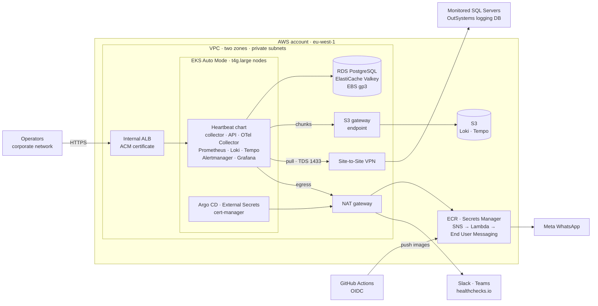

# AWS Production Infrastructure and Cost Forecast

What production on AWS is made of, what each part costs a month, and which
choices move the bill. Production is planned, not built
([roadmap](../product/roadmap.md), phase 5); the decisions behind it are
[ADR 0005](decisions/0005-production-delivery-and-operations-defaults.md)
(EKS, Argo CD, ECR, Secrets Manager, WhatsApp, healthchecks.io) and
[ADR 0015](decisions/0015-postgresql-and-redis-delivery.md) (RDS and
ElastiCache). This page sizes and prices them; it decides nothing an ADR has
not.

Prices last checked: **2026-11-09**, region **eu-west-1** (Ireland), US
dollars, before tax. [Refresh it](#how-to-refresh-this-forecast) before a
budget decision.

## Summary

| Scenario | On-demand | With a 1-year Compute Savings Plan on the nodes | With a 3-year plan |
| --- | --- | --- | --- |
| [Baseline](#baseline): one cluster, a few SQL Server targets, 1 GB of logs a day | **about $348** a month | about $329 | about $303 |
| [Growth](#growth): about 25 targets, 10 GB of logs a day, high availability | **about $544** a month | about $515 | about $476 |

Outside AWS: about $7 a month at baseline (GitHub Pro, WhatsApp template
fees) and $21 to $41 at growth ([non-AWS costs](#costs-outside-aws)).

Four lines are about 70% of the baseline: the EKS control plane ($73, fixed
per cluster), the nodes ($107 to $161), the NAT gateway ($35 to $71) and the
Site-to-Site VPN to the monitored databases ($37, only if they are outside
AWS). Storage, S3 and messaging together are under $30. The largest
avoidable risk is EKS extended support: a cluster left on a Kubernetes
version past standard support costs **$365 a month more**.

## Infrastructure

Every component, why it is there and how it is sized:

| Component | What and why | Sizing |
| --- | --- | --- |
| VPC | One VPC, two Availability Zones, a public and a private subnet in each. Nodes, the ALB and the data stores sit in private subnets | /16, no cost of its own |
| NAT gateway | Egress for ECR's API, Secrets Manager, STS, SNS, Slack, Teams and healthchecks.io | Baseline one, in one zone; growth one per zone |
| S3 gateway endpoint | Keeps Loki's and Tempo's chunks and ECR's image layers (stored in S3) off the NAT gateway | Free |
| EKS control plane | Kubernetes 1.36, standard support ([ADR 0005](decisions/0005-production-delivery-and-operations-defaults.md)) | One cluster |
| EKS Auto Mode | ADR 0005's default: AWS runs the nodes, VPC CNI with NetworkPolicy, EBS CSI and load balancing. Adds a management fee per node | See [nodes](#node-sizing) |
| Nodes | Graviton (arm64; the images are multi-arch) | Baseline 2 × t4g.large, growth 3 |
| EBS gp3 | Node volumes (Auto Mode's default 80 GiB each) and the chart's PVCs | Baseline 64 GiB of PVCs, growth 127 GiB |
| S3 | Loki chunks, ruler and compactor state; Tempo traces; CloudTrail logs | Baseline about 7 GB, growth about 61 GB |
| RDS for PostgreSQL 18 | The API's metadata ([ADR 0015](decisions/0015-postgresql-and-redis-delivery.md)), TLS, automated backups | Baseline db.t4g.micro Single-AZ, growth db.t4g.small Multi-AZ; 20 GiB gp3 |
| ElastiCache for Valkey | Sessions and job queue; nothing in it is a record (ADR 0015) | Baseline one cache.t4g.micro, growth a primary and a replica |
| ECR | Multi-arch images by digest and the OCI chart, pushed by GitHub Actions through OIDC | About 5 GB with a lifecycle policy |
| Secrets Manager | SQL Server logins, API database credentials, Grafana admin, webhook URLs, the healthchecks.io ping URL, synced by External Secrets with Pod Identity | Baseline 8 secrets, growth 25 |
| KMS | One customer-managed key for S3 and Secrets Manager; EBS and RDS use AWS-managed keys | 1 key |
| Internal ALB + ACM | Grafana and the API over HTTPS, one ALB shared through an ingress group; ACM's public certificate is free | 1 ALB |
| Route 53 | A private zone for the internal names and a public zone for ACM's DNS validation | 2 zones |
| CloudTrail | The free management-events trail, delivered to S3 | 1 trail |
| CloudWatch | Billing and NAT alarms, the Lambda's logs, EKS audit logs only if needed. Heartbeat watches itself in Prometheus ([ADR 0018](decisions/0018-heartbeats-own-telemetry.md)), so no Container Insights | A few GB a month |
| SNS → Lambda → End User Messaging Social | WhatsApp for critical alerts only ([ADR 0005](decisions/0005-production-delivery-and-operations-defaults.md)) | Inside the free tiers except the per-message fee |
| Connectivity to the SQL Servers | Still open in ADR 0005. Assumed: on-premises over one Site-to-Site VPN | 1 VPN connection |

Not included, each a separate decision: GuardDuty, Security Hub and AWS
Config; AWS Client VPN for operators ($73 a month per subnet association,
plus $0.05 per connection-hour); AWS Private CA ($400 a month; cert-manager's
in-cluster CA covers the collector's admin TLS); a staging cluster (about
$250 a month for a second copy of the fixed costs).

### Node sizing

Requests and memory limits from the chart's
[`values.yaml`](../../infra/helm/heartbeat/values.yaml), with the production
example's managed data stores (the bundled PostgreSQL and Valkey off):

| Workload | CPU request | Memory request | Memory limit |
| --- | --- | --- | --- |
| db-collector | 50m | 64 MiB | 256 MiB |
| API (+ migrate init container) | 50m | 64 MiB | 256 MiB |
| OTel Collector | 50m | 128 MiB | 512 MiB |
| Prometheus | 100m | 256 MiB | 1 GiB |
| Loki (single binary) | 100m | 256 MiB | 1 GiB |
| Tempo | 50m | 64 MiB | 384 MiB |
| Grafana | 50m | 128 MiB | 512 MiB |
| Alertmanager | not set | not set | not set |
| **Heartbeat** | **450m** | **0.94 GiB** | **3.9 GiB** |
| Argo CD, External Secrets, cert-manager (estimate) | about 600m | about 1.5 GiB | about 3 GiB |
| **All** | **about 1.1 vCPU** | **about 2.5 GiB** | **about 7 GiB** |

Measured use is far below the requests: the db-collector runs at about
3 millicores and 33 MiB, and the whole full profile on kind peaks at
1.85 GiB ([what the telemetry costs](../reference/metrics-and-endpoints.md#what-the-telemetry-costs)).
Sizing is therefore set by memory limits and by surviving the loss of one
node, not by CPU. Two t4g.large (2 vCPU, 8 GiB each, one per zone): either
one holds every request, and nearly every limit, while the other is replaced. A t4g's baseline is 30% of
its vCPUs (0.6 vCPU), above the measured load; CPU credits cover start-up
bursts.

Growth raises Loki's and Prometheus's limits to 2 to 4 GiB each for
10 GB of logs a day and about 40,000 series, so it adds a third node.

## Cost forecast

All prices are on-demand, 730 hours a month, from the AWS Price List API for
eu-west-1 ([sources](#sources)).

### Assumptions

| Input | Baseline | Growth | Where it comes from |
| --- | --- | --- | --- |
| Region | eu-west-1 | eu-west-1 | No doc names a region; Ireland offers every service used here. Re-price if another region is chosen |
| Clusters | 1 | 1 | `heartbeat-deploy` has one environment, `production` |
| SQL Server targets | about 5 + 1 OutSystems logging database | about 25 | **Unknown**; owner question |
| Logs into Loki | 1 GB a day | 10 GB a day | **Unknown**. Baseline from the measured 9.7 rows a second under PatientZero's steady load, at about 1 KB a row |
| Loki on S3 | 5:1 compression, 30-day retention: about 6 GB | about 60 GB | Retention from the chart (`retention_period: 30d`) |
| Traces | about 40 MB a day, 7-day retention | about 1 GB in all | Measured 80 MB a day on kind; production about half ([ADR 0018](decisions/0018-heartbeats-own-telemetry.md)) |
| Prometheus | 30-day retention on 50 GiB | 100 GiB | `production.example.yaml` sets 30 days and 50 GiB (the chart's default is 15 days) |
| Critical alerts | 30 a month, 3 recipients, firing and resolved: 180 messages | 100 a month, 5 recipients: 1,000 | **Unknown** |
| High availability | One NAT, Single-AZ RDS, one Valkey node | NAT per zone, Multi-AZ RDS, Valkey replica | Owner question |
| SQL Server location | On-premises, one Site-to-Site VPN | Same | Open in ADR 0005; owner question |
| Purchase | On-demand; Savings Plans shown apart | Same | |

### Baseline

| Line | Quantity | Unit price | Monthly |
| --- | --- | --- | --- |
| EKS control plane | 1 cluster | $0.10/h | $73.00 |
| Nodes | 2 × t4g.large | $0.0736/h | $107.46 |
| EKS Auto Mode fee | 2 × t4g.large | $0.00883/h | $12.89 |
| EBS node volumes | 2 × 80 GiB gp3 | $0.088/GB-month | $14.08 |
| EBS PVCs | 64 GiB gp3 (Prometheus 50, Loki 10, Tempo 2, Alertmanager 1, OTel queue 1, collector state 0.25) | $0.088/GB-month | $5.65 |
| EBS snapshots | about 30 GB (PVC backups) | $0.05/GB-month | $1.50 |
| NAT gateway | 1 × 730 h + 5 GB | $0.048/h, $0.048/GB | $35.28 |
| Public IPv4 | 1 (the NAT's) | $0.005/h | $3.65 |
| Internal ALB | 1 + 0.5 LCU on average | $0.0252/h, $0.008/LCU-h | $21.32 |
| Route 53 | 2 hosted zones | $0.50/zone | $1.00 |
| RDS for PostgreSQL | db.t4g.micro Single-AZ + 20 GiB gp3 | $0.017/h, $0.127/GB-month | $14.95 |
| ElastiCache for Valkey | 1 × cache.t4g.micro | $0.0136/h | $9.93 |
| ECR | 5 GB | $0.10/GB-month | $0.50 |
| Secrets Manager | 8 secrets + API calls | $0.40/secret | $3.23 |
| KMS | 1 key | $1/month | $1.00 |
| S3 | about 7 GB + requests | $0.023/GB-month | $1.00 |
| CloudWatch | about 2 GB of logs, alarms in the free 10 | $0.57/GB ingested | $2.00 |
| CloudTrail | management events (free) + S3 | | $0.50 |
| SNS, Lambda | inside the free tiers | | $0.00 |
| End User Messaging Social | 180 WhatsApp messages | $0.005/message (AWS fee) | $0.90 |
| Data transfer | cross-zone traffic in the cluster, a little internet egress | $0.01/GB each way between zones; $0.09/GB out | $2.00 |
| Site-to-Site VPN | 1 connection | $0.05/h | $36.50 |
| **Total** | | | **$348.34** |

### Growth

| Line | Quantity | Monthly |
| --- | --- | --- |
| EKS control plane | 1 cluster | $73.00 |
| Nodes | 3 × t4g.large | $161.18 |
| EKS Auto Mode fee | 3 nodes | $19.34 |
| EBS node volumes | 3 × 80 GiB | $21.12 |
| EBS PVCs | 127 GiB (Prometheus 100, Loki 20, Tempo 5, others 2) | $11.20 |
| EBS snapshots | about 60 GB | $3.00 |
| NAT gateways | 2 × 730 h + 10 GB | $70.56 |
| Public IPv4 | 2 | $7.30 |
| Internal ALB | 1 + 1 LCU on average | $24.24 |
| Route 53 | 2 zones | $1.00 |
| RDS for PostgreSQL | db.t4g.small Multi-AZ ($0.069/h) + 20 GiB Multi-AZ gp3 ($0.254/GB-month) | $55.45 |
| ElastiCache for Valkey | 2 × cache.t4g.micro (primary and replica) | $19.86 |
| ECR | 10 GB | $1.00 |
| Secrets Manager | 25 secrets | $10.10 |
| KMS | 1 key | $1.00 |
| S3 | about 61 GB + requests | $4.40 |
| CloudWatch | about 4 GB | $3.00 |
| CloudTrail | trail + S3 | $1.00 |
| End User Messaging Social | 1,000 messages | $5.00 |
| Data transfer | 10 GB of logs a day crossing zones twice ($0.02/GB) | $15.00 |
| Site-to-Site VPN | 1 connection | $36.50 |
| **Total** | | **$544.24** |

Not in either total: sharing telemetry as OTLP with applications outside AWS
([ADR 0019](decisions/0019-keep-grafana-and-share-telemetry-as-otlp.md)).
Each GB leaves through the NAT gateway and the internet, $0.048 + $0.09 =
**$0.138 a GB**: exporting 10 GB of logs a day adds about $41 a month. A
consumer in the same region over VPC peering costs $0.01 to $0.02 a GB
instead.

### Costs outside AWS

| Item | Baseline | Growth | Note |
| --- | --- | --- | --- |
| healthchecks.io | $0 | $0 to $20 | Hobbyist (free, 20 checks) is enough for one Watchdog per environment; Business ($20, 100 checks) when a team needs shared access |
| WhatsApp (Meta's fee) | about $3 | about $17 | Meta charges per delivered utility template message, since 1 October 2026 also inside the customer service window. Portugal is billed at Meta's "Rest of Western Europe" rate, about €0.014 a message (a third-party figure; the official rate card is a download from Meta's pricing page). AWS bills it through End User Messaging Social, converted from Meta's INR rate card |
| WhatsApp phone number | $0 | $0 | A number that can receive Meta's verification; an existing one works |
| GitHub Pro | $4 | $4 | Needed for the ruleset on the private `heartbeat-deploy` ([TODO 18](../../TODO.md)); Heartbeat itself is public, so its Actions minutes are free |
| Domain name | $0 | $0 | Assumes the organization's domain; a new `.com` through Route 53 is about $15 a year |

## Cost drivers and cheaper options

| Option | Saves a month | Trade-off |
| --- | --- | --- |
| Compute Savings Plan on the nodes, 1 year, no upfront | $19 (baseline), $29 (growth) | A commitment of $/hour for a year. Covers EC2 only, not the Auto Mode fee, the control plane or the data stores. RDS and ElastiCache have their own reserved instances |
| The same, 3 years | $45, $68 | Three-year lock-in for a product not yet in production |
| One NAT gateway instead of one per zone (the baseline already does this) | $35 | If its zone fails, egress stops: no image pulls, no secret refresh, no Slack, Teams or WhatsApp. healthchecks.io then stops receiving the Watchdog and alerts, so the outage is still noticed |
| A NAT instance (for example fck-nat on a t4g.nano) instead of the NAT gateway | about $30 | An instance to patch and replace yourself; no managed failover |
| VPC interface endpoints instead of a NAT gateway | none | $0.011 an hour per endpoint per zone: the six needed (ECR API, ECR Docker, STS, Secrets Manager, SNS, CloudWatch Logs) cost about $48 in one zone, more than the NAT. Slack, Teams and healthchecks.io still need internet egress |
| Managed node groups instead of Auto Mode | $13 to $19 | You run and upgrade CoreDNS, the VPC CNI, EBS CSI and the Load Balancer Controller, and patch node AMIs; reverses an ADR 0005 default |
| One node instead of two | $54 + $6 Auto Mode fee | A node replacement or zone failure is a full outage of monitoring and alerting |
| Node volumes of 20 GiB instead of Auto Mode's 80 | about $10 | Less room for images and logs on the node; set in the NodeClass |
| Graviton (already chosen) | 19% against t3.large ($0.0912/h) | The images must stay multi-arch, which the release already does |
| Spot capacity | not recommended | The workloads are singletons with state (collector, Prometheus, Loki); a two-minute interruption loses scrapes and alert evaluation. Only worth it for a separate pool of stateless, non-critical pods, which this cluster does not have |
| Prometheus retention 15 days (the chart default) instead of 30 | about $2 | Half the history for month-on-month comparisons |
| ElastiCache Serverless for Valkey | about $3 | Minimum 100 MB stored ($6.86) plus ECPUs; cheaper only while idle |
| The chart's own PostgreSQL instead of RDS | $15 | No managed backups, failover or patching; against ADR 0015 |
| SQL Servers reachable through VPC peering (if they run in AWS in this region) | $36.50 | Depends on where they are; peering has no hourly charge, only $0.01/GB between zones |

Costs to avoid:

- **EKS extended support**: $0.50 an hour on top of the $0.10 for a version
  past standard support, **+$365 a month**. ADR 0005's "newest minor EKS
  supports" keeps the cluster out of it; plan an upgrade about every four
  months.
- **EKS control-plane logs in CloudWatch**: $0.57 a GB ingested. Audit logs of
  a busy cluster run to several GB a month; turn on only what an
  investigation needs.
- **A second cluster for staging**: the fixed costs again (control plane,
  NAT, ALB, at least one node), about $250 a month. A `staging` namespace in
  the production cluster costs node capacity only, at the price of a shared
  failure domain.
- **Telemetry egress outside AWS** (above): $0.138 a GB.

## How to refresh this forecast

1. **Prices.** Read them from the AWS Price List API (no account needed):
   `https://pricing.us-east-1.amazonaws.com/offers/v1.0/aws/<service>/current/eu-west-1/index.json`
   for `AmazonEKS`, `AmazonVPC`, `AmazonS3`, `AmazonRDS`, `AmazonElastiCache`,
   `AmazonECR`, `AWSSecretsManager`, `AWSELB`, `AmazonRoute53`,
   `AmazonCloudWatch`, `AWSCloudTrail`, `AmazonSNS`, `AWSLambda`, `awskms`,
   `AWSDataTransfer`; `AmazonEC2` (EC2, EBS, NAT gateway, VPN data) is a
   280 MB `index.csv` in the same place. Compute Savings Plans rates are under
   `https://pricing.us-east-1.amazonaws.com/savingsPlan/v1.0/aws/AWSComputeSavingsPlan/current/region_index.json`.
   The [AWS Pricing Calculator](https://calculator.aws/) gives the same
   numbers by hand.
2. **Non-AWS prices.** healthchecks.io's and GitHub's pricing pages; Meta's
   WhatsApp rate card (EUR or USD list rates) for "Rest of Western Europe";
   AWS End User Messaging's pricing page for the AWS fee.
3. **Sizing inputs.** Resources and PVC sizes in the chart's `values.yaml`
   and `heartbeat-deploy`'s `environments/production/values.yaml`; retention
   (Loki `retention_period`, Prometheus `retention`, Tempo `retention`);
   measured use in [what the telemetry costs](../reference/metrics-and-endpoints.md#what-the-telemetry-costs).
4. **Real usage**, once production runs: replace the assumptions with Cost
   Explorer by service, Loki's ingested bytes
   (`loki_distributor_bytes_received_total`), the S3 bucket sizes, the
   number of targets in the inventory and the number of WhatsApp messages.
5. Update the tables, the summary and the date at the top in one pull
   request.

## Sources

Checked on 2026-11-09. AWS prices are from the AWS Price List API for
eu-west-1, publication dates 2026-09-11 to 2026-11-08 (EC2
2026-11-07, EKS 2026-10-27, RDS and S3 2026-11-04, Compute Savings Plans
2026-11-07).

- [Amazon EKS pricing](https://aws.amazon.com/eks/pricing/): control plane,
  extended support, Auto Mode
- [Amazon EC2 on-demand pricing](https://aws.amazon.com/ec2/pricing/on-demand/)
  and [Savings Plans pricing](https://aws.amazon.com/savingsplans/compute-pricing/)
- [Amazon VPC pricing](https://aws.amazon.com/vpc/pricing/): NAT gateway,
  public IPv4, endpoints, Site-to-Site VPN, Client VPN
- [Amazon EBS](https://aws.amazon.com/ebs/pricing/),
  [S3](https://aws.amazon.com/s3/pricing/),
  [RDS for PostgreSQL](https://aws.amazon.com/rds/postgresql/pricing/),
  [ElastiCache](https://aws.amazon.com/elasticache/pricing/),
  [ECR](https://aws.amazon.com/ecr/pricing/),
  [Secrets Manager](https://aws.amazon.com/secrets-manager/pricing/),
  [KMS](https://aws.amazon.com/kms/pricing/),
  [Elastic Load Balancing](https://aws.amazon.com/elasticloadbalancing/pricing/),
  [Route 53](https://aws.amazon.com/route53/pricing/),
  [CloudWatch](https://aws.amazon.com/cloudwatch/pricing/),
  [CloudTrail](https://aws.amazon.com/cloudtrail/pricing/),
  [SNS](https://aws.amazon.com/sns/pricing/),
  [Lambda](https://aws.amazon.com/lambda/pricing/)
- [AWS End User Messaging pricing](https://aws.amazon.com/end-user-messaging/pricing/):
  $0.005 per outbound WhatsApp message, Meta's fee passed through
- [WhatsApp Business Platform pricing](https://developers.facebook.com/documentation/business-messaging/whatsapp/pricing):
  per-message billing, rate cards effective 1 October 2026
- [healthchecks.io pricing](https://healthchecks.io/pricing/)
- [GitHub pricing](https://github.com/pricing)
